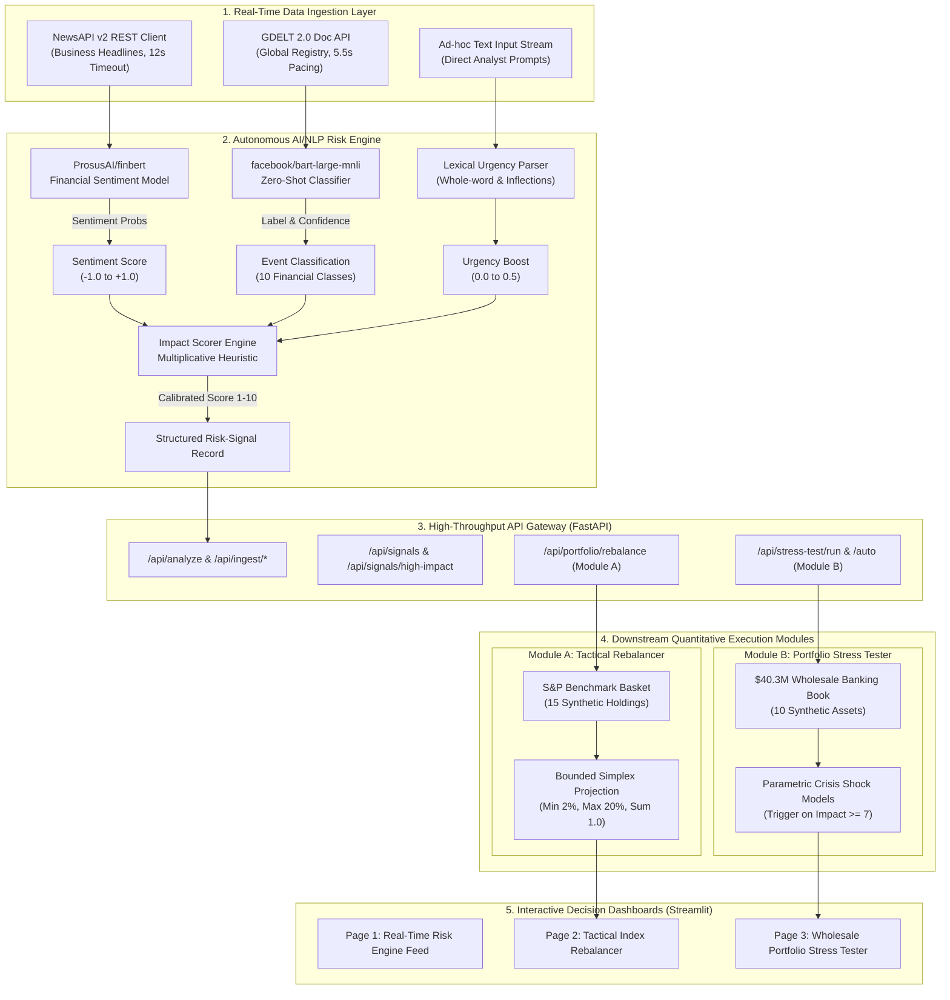

# Autonomous AI/NLP Financial Risk Engine & Decision Platform - S&P Global & Crisil Campus Hackathon

**Candidate Name:** Krishna Kapoor  
**College Email ID:** kkapoor2_be24@thapar.edu  
**College / Campus:** Thapar Institute of Engineering and Technology  
**Demo Video Link:** [YouTube Demo Video](https://youtu.be/9eZeS-aQFG4)  
**Slide Deck Link:** [Presentation Slide Deck (docs/presentation.pdf)](docs/presentation.pdf)  

---

## 1. Project Overview / Problem Statement & Approach

Modern financial markets generate massive volumes of high-velocity, unstructured text daily—spanning breaking news wires, central bank releases, regulatory actions, and geopolitical developments. Traditional quantitative risk systems operate primarily on lagging numerical indicators, such as historical volatility, delayed credit rating revisions, and quarterly financial statements. By the time emerging systemic or idiosyncratic risks manifest in asset prices, institutions often face severe information latency and capital drawdowns.

To explore how natural language processing can bridge this gap, this project implements a modular **Autonomous AI/NLP Financial Risk Engine & Decision Platform** prototype. The system ingests unstructured text feeds (NewsAPI, GDELT 2.0, or ad-hoc analyst submissions) and converts raw text into structured, machine-readable risk signals. The NLP pipeline pairs **ProsusAI/finbert** for financial sentiment polarity ($\text{Score} \in [-1.0, +1.0]$) with **facebook/bart-large-mnli** for zero-shot event classification across 10 financial categories. A transparent, rule-based **Impact Severity Formula** synthesizes sentiment magnitude, event category weights, whole-word urgency boosts, and classifier confidence into a calibrated severity score ($1\text{ to }10$).

These structured risk signals feed into two illustrative downstream financial modules:
- **Module A (Tactical Index Rebalancer):** Evaluates aggregated sentiment across holdings in a synthetic 15-stock S&P blue-chip equity basket and performs dynamic weight adjustments using a bounded-simplex projection algorithm (constraining individual weights to $2\%\text{--}20\%$ while strictly conserving a $1.0$ sum) with a configurable noise filter.
- **Module B (Strategic Wholesale Banking Portfolio Stress Tester):** Enables automated scenario execution across a synthetic \$40.3M multi-asset wholesale banking portfolio (sovereign debt, corporate bonds, equities, commercial loans, and derivatives) when qualifying high-impact risk signals ($\ge 7/10$) are detected.

> **Note on Prototype Scope:** This platform is an exploratory prototype designed to demonstrate an end-to-end risk intelligence pipeline. The scoring formulas, synthetic portfolio holdings, and stress shock factors are illustrative parametric heuristics and have not been historically calibrated or backtested on production tick or order-book data.

---

## 2. Architecture & Tech Stack

### System Design & Data Flow


The application follows a modular, five-layer dataflow architecture:



### Signal Transformation & Mathematical Formulas

1. **Continuous Sentiment Scoring ($\text{FinBERT}$):**
   $$\text{Sentiment Score} = P(\text{Positive}) - P(\text{Negative}) \in [-1.0, +1.0]$$
   - Uses `ProsusAI/finbert` to compute probabilities over `[positive, negative, neutral]`.
   - The analyzer normalizes varying Transformers output shapes (nested lists, flat lists, or single dicts) and safely falls back to neutral (`0.0`) if malformed outputs occur.

2. **Zero-Shot Event Classification ($\text{BART-Large-MNLI}$):**
   - Evaluates natural language inference pairs across 10 configured candidate labels: `Geopolitical`, `Macroeconomic`, `Credit Event`, `Merger/Acquisition`, `Product Launch`, `Regulatory`, `Earnings Report`, `Natural Disaster`, `Legal/Lawsuit`, and `Market Volatility`.
   - Returns the top-ranked category alongside its inference confidence score $\in [0.0, 1.0]$.

3. **Multiplicative Impact Severity Formula:**
   $$\text{Raw Score} = 10 \cdot |\text{Sentiment}| \times W_{\text{event}} \times (1 + B_{\text{urgency}}) \times (0.5 + 0.5 \cdot \text{Confidence})$$
   $$\text{Impact Score} = \max\left(1, \; \min\left(10, \; \text{round}\left(\frac{\text{Raw Score}}{2.4}\right)\right)\right)$$
   Where:
   - $|\text{Sentiment}| \in [0.0, 1.0]$: Directional sentiment magnitude. Anchoring to magnitude prevents neutral market news from triggering false alarms.
   - $W_{\text{event}} \in [0.8, 1.6]$: Domain category weight (`Credit Event`: 1.6, `Geopolitical`: 1.5, `Macroeconomic`: 1.4, `Market Volatility`: 1.3, `Regulatory`: 1.2, `Earnings Report`: 1.1, `Legal/Lawsuit`: 1.1, `Natural Disaster`: 1.1, `Merger/Acquisition`: 1.0, `Product Launch`: 0.8).
   - $B_{\text{urgency}} = \min(0.1 \times N_{\text{unique\_keywords}}, \; 0.5)$: Lexical urgency boost. Evaluated via a precompiled regex matching whole words and common inflections (e.g., *crash/crashes/crashed*, *crisis/crises*, *sanction/sanctions*, *bankruptcy/bankruptcies*). This prevents false substring matches (such as `"war"` matching inside `"award"`).
   - $\text{Confidence} \in [0.0, 1.0]$: Scaled NLI classifier confidence in $[0.5, 1.0]$ to modulate signal reliability.
   - $2.4$: Theoretical maximum normalization denominator ($\text{Max Raw} = 10 \times 1.6 \times 1.5 \times 1.0 = 24.0$), mapping output onto the $1\text{ to }10$ integer scale.

4. **Bounded Simplex Portfolio Projection (Module A):**
   - Clamping adjusted weights and re-normalizing by dividing by their sum can mathematically violate box bounds. 
   - To guarantee that every holding $w_i \in [w_{\min}, w_{\max}] = [0.02, 0.20]$ while strictly maintaining $\sum_{i=1}^n w_i = 1.0$, Module A implements a bisection search over a uniform shift parameter $\lambda$:
     $$w_i(\lambda) = \min\left(w_{\max}, \; \max\left(w_{\min}, \; \tilde{w}_i - \lambda\right)\right) \quad \text{such that} \quad \sum_{i=1}^n w_i(\lambda) = 1.0$$
   - A final deterministic residual reconciliation step distributes any $10^{-6}$ rounding remainder without crossing box constraints.

### Key Frameworks & Libraries

| Component | Technology | Rationale & Responsibility |
| :--- | :--- | :--- |
| **Deep Learning & NLP** | `Hugging Face Transformers`, `PyTorch 2.5+` | Tokenization and inference for `ProsusAI/finbert` and `facebook/bart-large-mnli`. |
| **Backend Framework** | `FastAPI`, `Pydantic v2`, `Uvicorn` | Asynchronous REST gateway with input validation schemas, bounded query parameters, and proper route precedence. |
| **Data Ingestion** | `Requests`, `gdeltdoc` | HTTP clients with status code mapping (401 invalid key, 429 rate limit), 12s timeout for NewsAPI, and 5.5s pacing for GDELT. |
| **Quantitative Modeling** | `NumPy`, `Pandas` | Parametric portfolio valuation, bounded simplex weight projection, and cross-asset shock calculations. |
| **User Interface** | `Streamlit`, `Plotly` | Multi-page decision dashboard with interactive sensitivity controls, delta bar charts, and scenario inspection. |
| **Testing & Verification** | `Pytest` | Comprehensive test suite covering API routes, bounded rebalancer invariants, stress testing, and impact scoring (15/15 passing). |

---

## 3. Dataset Used

### Source & Nature of Sample Data

1. **Unstructured News Streams:**
   - **NewsAPI v2 (`/top-headlines` & `/everything`):** Ingests live financial headlines across major publications. Requires a `NEWSAPI_KEY` in `.env`.
   - **GDELT 2.0 Doc API:** Real-time global database of events and conflict monitoring spanning multilingual news outlets (filtered for English business articles). Requires no authentication.
   - **Benchmark Ingested Headlines:** Packaged in `data/raw/sample_financial_news.json` for deterministic offline testing and CLI demonstrations.

2. **Synthetic S&P Benchmark Basket (Module A):**
   - 15 large-cap US equities (`AAPL`, `MSFT`, `GOOGL`, `AMZN`, `NVDA`, `META`, `JPM`, `BAC`, `XOM`, `JNJ`, `V`, `PG`, `HD`, `UNH`, `MA`).
   - Starting weights are synthetically configured in `data/portfolio/mock_index.json` and sum strictly to 1.0.

3. **Synthetic Wholesale Banking Portfolio (Module B):**
   - A \$40,300,000 multi-asset balance sheet spanning 10 synthetic holdings across 5 asset classes (`data/portfolio/synthetic_portfolio.json`):
     - **Government Bonds:** US Treasury 10Y Bond (\$10.0M, AAA, Duration ~7 yrs)
     - **Corporate Bonds:** TechCorp Senior Bond (\$5.0M, A), EnergyCo Bond (\$4.0M, BBB)
     - **Equities:** AAPL Holding (\$3.0M), JPM Holding (\$2.5M), XOM Holding (\$2.0M)
     - **Commercial Loans:** RetailCo Term Loan (\$8.0M, BBB), MfgCorp Revolver (\$5.0M, BB)
     - **Derivatives:** Interest Rate Swap (\$500k MTM), Credit Default Swap (\$300k MTM)

### Scope & Assumptions

- **Semantic Granularity:** Text processing operates on headline and lead summary text rather than full multi-page filings.
- **Entity Resolution:** Company associations rely on ticker and name matching; automated entity coreference and cross-source article deduplication are omitted in this prototype.
- **Sensitivity-Based Stress Dynamics:** Bond price movements approximate duration sensitivities; commercial loan losses reflect a direct default-shock rate; derivative losses apply a mark-to-market volatility shock. The prototype does not model full instrument-level Greeks, cash flow waterfalls, loss given default (LGD), or regulatory capital ratios (e.g., Basel III / CCAR).

---

## 4. Quickstart & Installation

**Runtime:** Python 3.10+ / 3.11 with PyTorch 2.5+ on Windows, Linux, or macOS.

### Step-by-Step Commands to Set Up Environment and Run Locally:

```bash
# 1. Clone the repository
git clone https://github.com/KrishnaKapoor612/Autonomous-AI-NLP-Financial-risk-engine.git
cd Autonomous-AI-NLP-Financial-risk-engine

# 2. Create and activate a virtual environment
python -m venv venv
# On Windows:
.\venv\Scripts\activate
# On Linux/macOS:
source venv/bin/activate

# 3. Install required dependencies
pip install -r requirements.txt

# 4. (Optional) Configure API Keys in .env
# Copy template and add your NewsAPI key if running live news queries:
cp .env.example .env

# 5. Run the End-to-End Pipeline Demo
python main.py
```

### Operational Run Commands & Entry Points:

- **End-to-End Pipeline CLI Execution**:
  ```bash
  python main.py
  ```
  *Executes the complete pipeline: model initialization $\rightarrow$ sample feed ingestion $\rightarrow$ NLP signal generation $\rightarrow$ Module A bounded rebalancing $\rightarrow$ Module B portfolio stress test.*

- **Launch Interactive Streamlit Multi-Page Dashboard**:
  ```bash
  python main.py --dashboard
  # Or directly:
  streamlit run dashboards/main_dashboard.py
  ```
  *Access interactive UI at `http://localhost:8501`.*

- **Launch High-Performance FastAPI REST Server**:
  ```bash
  python main.py --api
  # Or directly:
  uvicorn src.api.main:app --reload --port 8000
  ```
  *Access Swagger documentation at `http://localhost:8000/docs`.*

- **Launch Full Stack (API + Dashboard Simultaneously)**:
  ```bash
  python main.py --all
  ```

- **Run Automated Test Suite**:
  ```bash
  pytest tests/
  ```
  *Runs 15 automated unit and integration tests covering API routing, NLP scoring bounds, bounded-simplex rebalancing invariants, and stress test calculations.*

### Primary API Routes

- `POST /api/analyze` & `POST /api/analyze/batch`: Analyze arbitrary text for sentiment, classification, and impact score.
- `POST /api/ingest/news` & `POST /api/ingest/gdelt`: Fetch and process live feeds from external APIs.
- `GET /api/signals`: Retrieve stored risk signals (supports `limit` parameter, bounded $1\text{--}500$).
- `GET /api/signals/high-impact`: Retrieve signals filtered by threshold (bounded $1\text{--}10$).
- `GET /api/signals/{ticker}`: Query historical signals for an individual stock ticker.
- `GET /api/portfolio/weights` & `POST /api/portfolio/rebalance`: Inspect and execute bounded rebalancing for Module A.
- `POST /api/stress-test/run` & `POST /api/stress-test/auto`: Run specific scenario shocks or trigger shocks automatically based on stored high-impact signals for Module B.

---

## 5. Key Results & Domain Impact

### What the Prototype Demonstrates

1. **Sub-Second Unstructured Text Triage:**
   - Ingests unstructured financial text and converts it into structured, auditable risk-signal records containing continuous sentiment, event classifications, urgency factors, and a bounded impact severity score ($1\text{ to }10$).
   - Exposes all intermediate scoring components so that every score is interpretable and verifiable by risk analysts.

2. **Noise-Protected Tactical Rebalancing (Module A):**
   - Aggregates ticker-level sentiment across multiple signals and applies adjustments only when the absolute net sentiment exceeds the configured threshold ($0.01\text{ to }0.50$, default $0.05$), filtering out market noise.
   - Applies bounded simplex projection to mathematically ensure that individual asset weights never breach the $2\%$ minimum or $20\%$ maximum concentration constraints, while preserving a portfolio sum of exactly $100\%$.

3. **Event-Driven Portfolio Stress Testing (Module B):**
   - Automatically detects qualifying high-impact events ($\text{Impact Score} \ge 7$) and triggers multi-asset stress testing across 6 discrete macroeconomic, geopolitical, credit, and regulatory crisis scenarios.
   - Provides clear before-and-after portfolio balance sheet loss breakdowns across fixed income, equity, loan, and derivative holdings.

### Domain Relevance & Business Impact for Financial Institutions

- **Mitigating Information Latency:** Financial market headlines often precede price adjustments by minutes or hours. Demonstrating a pipeline that extracts actionable signals directly from live unstructured feeds provides risk managers and quantitative desks with early indicators of emerging volatility.
- **Explainable Heuristics for Decision Support:** Unlike opaque black-box scoring systems, the pipeline preserves full auditability: an analyst can verify whether an impact score was driven by high sentiment polarity, high-risk event classification, or specific urgency terms.
- **Workflow Automation:** Integrates ingestion, NLP scoring, tactical rebalancing, and stress-testing into unified REST endpoints and interactive visual dashboards, illustrating how manual analytical workflows can be streamlined.

### Limitations & Production Validation Roadmap

Before translating this prototype into a production risk engine, several engineering and quantitative enhancements are necessary:
- **Historical Score Calibration:** Calibrate event category weights and urgency multipliers against labeled historical market events and realized volatility distributions.
- **Execution & Liquidity Modeling:** Extend Module A's rebalancer to factor in bid-ask spreads, transaction costs, market depth, and execution slippage.
- **Instrument-Level Valuation:** Upgrade Module B from parametric sensitivities to full instrument-level pricing models (e.g., option Greeks, discount curve shifts, counterparty transition matrices, and PD/LGD credit risk modeling).
- **Production Hardening:** Implement API authentication, granular CORS origin restrictions, rate limiting, and model performance/drift monitoring.
