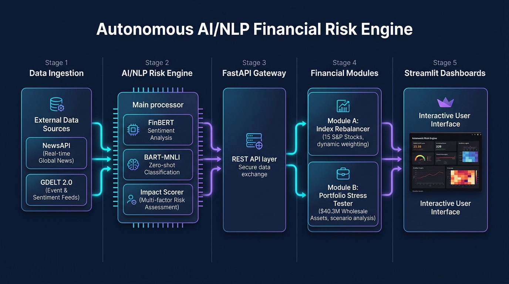
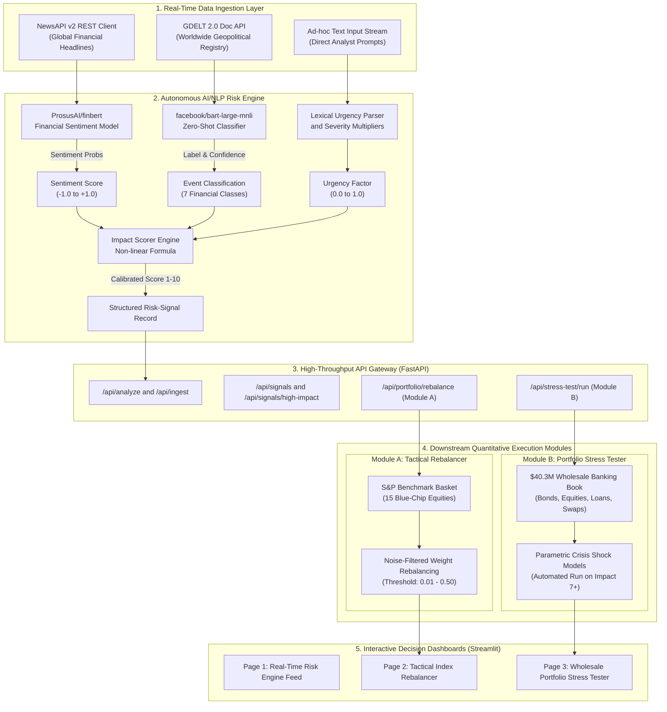

# Autonomous AI/NLP Financial Risk Engine & Decision Platform - S&P Global & Crisil Campus Hackathon

**Candidate Name:** Krishna Kapoor
**College Email ID:**  kkapoor2_be24@thapar.edu
**College / Campus:** Thapar Institute of Engineering and Technology 
**Demo Video Link:** [\[YouTube / Unlisted\]  ](https://youtu.be/9eZeS-aQFG4)
**Slide Deck Link (within the repo in docs folder):**  [Presentation Slide Deck (docs/presentation.pdf)](docs/presentation.pdf)

---

## 1. Project Overview / Problem Statement & Approach

Modern financial markets generate massive volumes of high-velocity, unstructured text daily—spanning breaking news wires, central bank policy announcements, macroeconomic bulletins, regulatory updates, and geopolitical developments. Traditional quantitative risk systems operate primarily on backward-looking numerical indicators such as historical price volatility, credit spreads, and delayed quarterly filings. By the time emerging systemic or company-specific risks manifest in exchange prices, institutions have already suffered irrecoverable capital drawdown and severe information latency.

To address this challenge, we developed an enterprise-grade, autonomous **AI/NLP Financial Risk Engine & Decision Platform**. The system ingests high-velocity unstructured news from real-time global feeds (NewsAPI and GDELT 2.0 Global Event Database) and transforms raw market text into structured, machine-readable risk signals. The NLP pipeline couples **ProsusAI/finbert** for high-precision financial sentiment quantification ($\text{Score} \in [-1.0, +1.0]$) with **facebook/bart-large-mnli** for zero-shot event classification across seven financial categories without requiring labeled historical datasets. An analytical **Impact Severity Formula** synthesizes sentiment magnitude, classifier confidence, lexical urgency heuristics, and systemic risk premiums into a calibrated severity score ($1\text{ to }10$).

These standardized risk signals drive two critical downstream financial applications: **Module A (Tactical Index Rebalancer)**, which performs sentiment-driven dynamic weight rebalancing on a representative 15-stock S&P blue-chip equity benchmark basket with configurable noise threshold filters, and **Module B (Strategic Wholesale Banking Portfolio Stress Tester)**, which enables automated execution of parametric crisis shocks across a \$40.3M multi-asset banking portfolio (sovereign bonds, corporate debt, equities, commercial loans, and derivatives) derived from qualifying high-impact risk signals ($\ge 7/10$).

---

## 2. Architecture & Tech Stack

### System Design & Data Flow



The platform is designed around a decoupled, microservices-oriented architecture organized into five distinct layers:



### Signal Transformation & Mathematical Foundations

1. **Continuous Sentiment Scoring ($\text{FinBERT}$)**:
   $$\text{Sentiment Score} = P(\text{Positive}) - P(\text{Negative}) \in [-1.0, +1.0]$$
2. **Zero-Shot Event Classification ($\text{BART-Large-MNLI}$)**:
   Evaluates premise-hypothesis natural language inference pairs across candidate labels: `Macroeconomic`, `Geopolitical`, `Credit Event`, `Regulatory`, `Earnings Report`, `Merger/Acquisition`, and `Natural Disaster`.
3. **Calibrated Impact Severity Formula**:
   $$\text{Raw Score} = 10 \cdot |\text{Sentiment}| \times W_{\text{event}} \times (1 + B_{\text{urgency}}) \times (0.5 + 0.5 \cdot \text{Confidence})$$
   $$\text{Impact Score} = \max\left(1, \; \min\left(10, \; \text{round}\left(\frac{\text{Raw Score}}{2.4}\right)\right)\right)$$

   Where:
   - $|\text{Sentiment}| \in [0.0, 1.0]$: Directional FinBERT sentiment magnitude ($|P(\text{Positive}) - P(\text{Negative})|$). Anchoring raw score to sentiment magnitude ensures that neutral market news does not trigger false risk alarms.
   - $W_{\text{event}} \in [0.8, 1.6]$: Domain-calibrated event category weight from `config/settings.py` (e.g., `Credit Event`: 1.6, `Geopolitical`: 1.5, `Macroeconomic`: 1.4, down to `Product Launch`: 0.8).
   - $B_{\text{urgency}} = \min(0.1 \times N_{\text{keywords}}, \; 0.5)$: Lexical urgency multiplier boosting impact by up to +50% when high-volatility financial keywords (*crisis*, *crash*, *default*, *recession*, etc.) are detected.
   - $\text{Confidence} \in [0.0, 1.0]$: Zero-shot NLI classifier confidence scaled to $[0.5, 1.0]$ to modulate signal reliability.
   - $2.4$: Theoretical maximum normalization denominator ($\text{Max Raw} = 10 \times 1.6 \times 1.5 \times 1.0 = 24.0$), mapping the output into the standard $1\text{ to }10$ integer scale.

### Key Frameworks, Databases & AI/ML Libraries

| Component | Technology | Rationale & Responsibility |
| :--- | :--- | :--- |
| **Deep Learning & NLP** | `Hugging Face Transformers`, `PyTorch` | Tokenization and GPU/CPU inference for `ProsusAI/finbert` and `facebook/bart-large-mnli`. |
| **Backend Framework** | `FastAPI`, `Starlette`, `Uvicorn` | High-throughput asynchronous REST API with Starlette threadpool offloading for CPU-bound transformer tasks. |
| **Data Validation** | `Pydantic v2` | Strict schema validation for ingestion requests, signals, and rebalancing parameters. |
| **Data Ingestion** | `NewsAPI Client`, `Requests` | Asynchronous/resilient HTTP clients with connection pooling, retries, and timeout resilience for GDELT 2.0 and NewsAPI. |
| **Quantitative Modeling** | `NumPy`, `Pandas` | Parametric portfolio valuation, S&P weight normalization, and multi-asset shock calculations. |
| **User Interface** | `Streamlit`, `Plotly Express / Graph Objects` | Real-time multi-page dashboard featuring interactive charts, sensitivity sliders, and before-vs-after delta views. |
| **Testing & QA** | `Pytest` | Comprehensive test suite covering API endpoints, ingestion resilience, NLP scoring, and financial logic (15/15 passing). |

---

## 3. Dataset Used

### Source & Nature of Sample Data

1. **Public Financial News Feeds**:
   - **NewsAPI v2**: Live headlines queried across major business publications (Reuters, Bloomberg, Wall Street Journal, Financial Times, CNBC).
   - **GDELT 2.0 Doc API**: Real-time global database of events and conflict monitoring spanning multilingual international news outlets.
   - **Sample Ingested Data**: A benchmark collection of categorized financial headlines is bundled in `data/raw/sample_financial_news.json`.

2. **Synthetic S&P Benchmark Equity Basket (Module A)**:
   - A representative 15-stock large-cap blue-chip basket (`AAPL`, `MSFT`, `GOOGL`, `AMZN`, `NVDA`, `META`, `JPM`, `BAC`, `XOM`, `JNJ`, `V`, `PG`, `HD`, `UNH`, `MA`).
   - Baseline weights are capitalization-weighted and strictly sum to 1.0 (stored in `data/portfolio/mock_index.json`).

3. **Synthetic Wholesale Banking Portfolio (Module B)**:
   - A \$40,300,000 multi-asset institutional balance sheet spanning 10 holdings across 5 asset classes (stored in `data/portfolio/synthetic_portfolio.json`):
     - **Government Bonds**: US Treasury 10Y Bond (\$10,000,000, AAA, Duration ~7 yrs)
     - **Corporate Bonds**: TechCorp Senior Bond (\$5M, A), EnergyCo Bond (\$4M, BBB)
     - **Equities**: AAPL Holding (\$3M), JPM Holding (\$2.5M), XOM Holding (\$2M)
     - **Commercial Loans**: RetailCo Term Loan (\$8M, BBB), MfgCorp Revolver (\$5M, BB)
     - **Derivatives**: Interest Rate Swap (\$500k MTM), Credit Default Swap (\$300k MTM)

### Assumptions Made About the Data

- **Semantic Density**: Article titles and lead summaries contain sufficient semantic density for sub-second NLP risk classification without parsing entire multi-page articles.
- **Zero-Shot Transferability**: Pre-trained NLI entailment models (`BART-Large-MNLI`) generalize effectively to financial event taxonomy without catastrophic distribution drift.
- **Liquidity & Asset Rebalancing**: The benchmark basket assumes adequate market depth for weight adjustments bounded by minimum (2%) and maximum (20%) per-stock concentration constraints.
- **Fixed Income Duration Dynamics**: Corporate bonds approximate a 5-year duration under credit spread widening; 10-year US Treasuries approximate a 7-year duration and exhibit flight-to-safety price appreciation during crisis events.

---

## 4. Quickstart & Installation-

**Runtime:** Python 3.10+ / 3.11 on Windows, Linux, or macOS.

### Step-by-Step Commands to Set Up Environment and Run Locally:

```bash
# 1. Clone the repository
git clone https://github.com/KrishnaKapoor612/Autonomous-AI-NLP-Financial-risk-engine
cd Autonomous-AI-NLP-Financial-risk-engine

# 2. Create and activate a virtual environment
python -m venv venv
# On Windows:
.\venv\Scripts\activate
# On Linux/macOS:
source venv/bin/activate

# 3. Install required dependencies
pip install -r requirements.txt

# 4. (Optional) Configure API Keys in .env
# Copy the template and add your NewsAPI key if running live news queries:
cp .env.example .env

# 5. Run the End-to-End Pipeline Demo
python main.py
```

### Operational Run Commands & Entry Points:

- **End-to-End Pipeline CLI Execution**:
  ```bash
  python main.py
  ```
  *Executes the complete pipeline: model initialization $\rightarrow$ sample feed ingestion $\rightarrow$ NLP signal generation $\rightarrow$ Module A index rebalancing $\rightarrow$ Module B portfolio stress test.*

- **Launch Interactive Streamlit Multi-Page Dashboard**:
  ```bash
  python main.py --dashboard
  # Or directly:
  streamlit run dashboards/main_dashboard.py
  ```
  *Opens the interactive graphical dashboard at `http://localhost:8501`.*

- **Launch High-Performance FastAPI REST Server**:
  ```bash
  python main.py --api
  # Or directly:
  uvicorn src.api.main:app --reload --port 8000
  ```
  *Interactive Swagger API documentation accessible at `http://localhost:8000/docs`.*

- **Launch Full Stack (API + Dashboard Simultaneously)**:
  ```bash
  python main.py --all
  ```

- **Run Automated Test Suite (15 Unit & Integration Tests)**:
  ```bash
  python main.py --test
  # Or directly:
  pytest tests/
  ```

---

## 5. Key Results & Domain Impact

### What the Prototype Outputs & Demonstrates

1. **Sub-Second Unstructured Text Triage**:
   - Converts arbitrary financial headlines into standardized, structured risk-signal records.
   - Provides granular sentiment scores with confidence metrics and multi-class event distributions.
2. **Tactical Index Rebalancer with Noise Protection (Module A)**:
   - Evaluates aggregate sentiment across holdings and dynamically shifts weights toward positive-sentiment leaders while pruning high-risk holdings.
   - Enforces a configurable **Sentiment Noise Threshold** ($0.01\text{ to }0.50$, default $0.05$) to prevent costly portfolio turnover on near-neutral news chatter.
   - Visualizes Before vs After allocation deltas with interactive Plotly grouped bar charts and one-click benchmark resets.
3. **Strategic Wholesale Banking Portfolio Stress Testing (Module B)**:
   - Simulates institutional balance sheet vulnerability under 6 parametric shock scenarios (`Geopolitical`, `Macroeconomic`, `Credit Event`, `Regulatory`, `Merger/Acquisition`, `Natural Disaster`).
   - Enables automated stress testing derived from detected high-impact signals ($\text{Impact Score} \ge 7/10$) via one-click dashboard action or API integration.
   - Captures realistic cross-asset dynamics, including credit spread widening, loan default surges, equity drawdowns, and sovereign debt flight-to-safety price appreciation.

### Domain & Business Impact for S&P Global & Financial Institutions

- **Information Arbitrage & Early-Warning Alpha**: Traditional models act hours or days after price collapses occur; our autonomous NLP engine detects nascent risks at the headline stage, giving portfolio managers and traders a crucial first-mover advantage.
- **Institutional Capital Preservation**: Real-time stress testing projects PnL drawdowns across a multi-million-dollar banking book instantly, empowering Chief Risk Officers (CROs) to hedge counterparty and sector exposures preemptively.
- **Regulatory Compliance & CCAR / Basel III Readiness**: Automates scenario analysis and capital adequacy simulation, eliminating weeks of manual spreadsheet modeling for regulatory reporting.
- **Explainable & Scalable Decision-Making**: By combining transparent mathematical formulas with fine-tuned transformers, every portfolio shift and stress test outcome is fully auditable and explainable.
